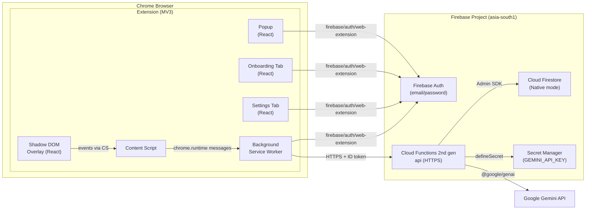
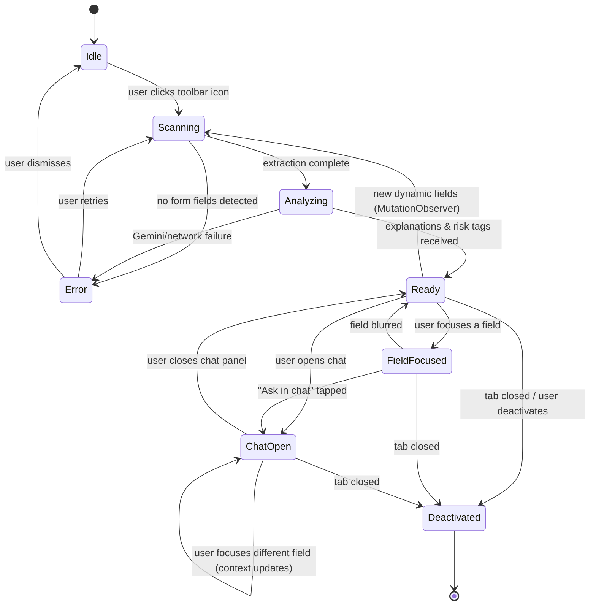

# FormAssist — Implementation Plan v1

> **Status:** DRAFT — awaiting your approval before any code is written.

---

## 1. Architecture Overview



### Key architectural decisions

| Decision | Rationale |
|---|---|
| **Cloud Functions for Firebase (2nd gen, not Vercel)** | Your request overrides the SRS v1.2's Vercel pivot. Single `api` function with Express-style internal routing. Region `asia-south1`. `maxInstances` capped. |
| **No Firestore client SDK in extension** | Per NFR-DATA.4. All Firestore access goes through the Cloud Function via Admin SDK. |
| **`firebase/auth/web-extension` entry point** | Used in popup, onboarding, options pages AND the background service worker. Follows Firebase's "Authenticate in Chrome extension" guide. |
| **Content script → Background → Function** | Content script never sees tokens. Background SW attaches the ID token from its Auth instance. |
| **Shadow DOM isolation** | All injected overlay UI rendered inside a Shadow DOM root to prevent CSS collisions (FR-UI.3). |
| **Three run modes via `VITE_API_MODE`** | `mock` (no Firebase, canned data), `emulator` (local Firebase emulators), `live` (deployed project). Mock mode is built first. |

---

## 2. SRS Deviations & Reconciliation

The SRS v1.2 specifies Vercel Hobby hosting. Your request explicitly specifies Cloud Functions for Firebase (2nd gen, Blaze plan). I follow **your request** as the authority. Specific overrides:

| SRS v1.2 says | We do instead | Why |
|---|---|---|
| Vercel Hobby for API hosting | Cloud Functions 2nd gen (`asia-south1`) | Your explicit instruction |
| Service-account key in env var | Admin SDK auto-initializes in Cloud Functions environment | No key needed when running in CF; emulator mode uses `FIRESTORE_EMULATOR_HOST` |
| NFR-PRIV.4 Gemini free-tier disclosure language | Keep the disclosure but note the backend is on Blaze, Gemini key is via Secret Manager | Blaze ≠ free tier for Functions; Gemini free tier terms still apply to the Gemini API key itself |

---

## 3. Repository Layout (File Tree)

```
formassist/
├── extension/                          # Vite + React + TypeScript
│   ├── public/
│   │   ├── manifest.json               # MV3 manifest
│   │   └── icons/                      # Extension icons (16, 32, 48, 128)
│   ├── src/
│   │   ├── popup/                      # Popup entry point
│   │   │   ├── index.html
│   │   │   ├── main.tsx
│   │   │   ├── Popup.tsx               # Root component, state switch p1-p4 + error
│   │   │   └── components/
│   │   │       ├── SignedOutView.tsx    # p1
│   │   │       ├── IdleView.tsx        # p2
│   │   │       ├── WorkingView.tsx     # p3
│   │   │       ├── ReadyView.tsx       # p4
│   │   │       ├── ErrorView.tsx       # (no mockup — designed fresh)
│   │   │       └── LanguageToggle.tsx
│   │   ├── onboarding/                 # Full-tab onboarding (4 steps)
│   │   │   ├── index.html
│   │   │   ├── main.tsx
│   │   │   ├── Onboarding.tsx
│   │   │   └── steps/
│   │   │       ├── WelcomeStep.tsx     # o1
│   │   │       ├── LanguageStep.tsx    # o2
│   │   │       ├── PrivacyStep.tsx     # o3
│   │   │       └── AccountStep.tsx     # o4
│   │   ├── options/                    # Settings page (s1)
│   │   │   ├── index.html
│   │   │   ├── main.tsx
│   │   │   └── Settings.tsx
│   │   ├── background/
│   │   │   ├── service-worker.ts       # MV3 background SW entry
│   │   │   ├── auth.ts                 # Firebase Auth (web-extension) init + token mgmt
│   │   │   ├── api-client.ts           # Fetch wrapper: attaches ID token, routes to mock/emulator/live
│   │   │   └── session-manager.ts      # Tab-scoped state machine (Idle→Scanning→…→Deactivated)
│   │   ├── content/
│   │   │   ├── content-script.ts       # Entry: creates Shadow DOM host, loads overlay
│   │   │   ├── extractor.ts            # DOM scan: fields, labels (FR-EXTRACT.1-4), MutationObserver
│   │   │   ├── redactor.ts             # Enforces FR-REDACT.1-4 at extraction time
│   │   │   ├── risk-analyzer.ts        # Client-side heuristic risk tags (FR-RISK.1-4), uses tldts
│   │   │   └── messaging.ts            # chrome.runtime.sendMessage wrappers
│   │   ├── overlay/                    # React app rendered inside Shadow DOM
│   │   │   ├── main.tsx                # Shadow DOM React root bootstrap
│   │   │   ├── OverlayApp.tsx          # Top-level: listens to session state
│   │   │   ├── components/
│   │   │   │   ├── ProgressCard.tsx    # Scanning/Analyzing progress (like p3 popup)
│   │   │   │   ├── FieldTag.tsx        # "ⓘ See description" tag (Required/Optional/Unusual)
│   │   │   │   ├── Tooltip.tsx         # Collapsed (summary) / Expanded (full + source + listen)
│   │   │   │   ├── RiskBanner.tsx      # Dismissible top-of-page risk banner
│   │   │   │   ├── ChatPanel.tsx       # Slide-in chat drawer
│   │   │   │   ├── ChatMessage.tsx     # Single chat bubble
│   │   │   │   ├── ErrorCard.tsx       # Overlay error state (Retry + Dismiss)
│   │   │   │   └── SourceBadge.tsx     # "From this page" / "From official source" / "AI knowledge"
│   │   │   └── hooks/
│   │   │       ├── useSessionState.ts
│   │   │       ├── useExplanations.ts
│   │   │       └── useTTS.ts           # speechSynthesis wrapper
│   │   ├── shared/
│   │   │   ├── firebase-config.ts      # Firebase web config (public), conditional emulator connect
│   │   │   ├── auth-init.ts            # initializeAuth with web-extension persistence
│   │   │   ├── types.ts                # Shared TypeScript interfaces (Field, Explanation, RiskFlag, etc.)
│   │   │   ├── constants.ts            # Language codes, risk severity, source labels
│   │   │   ├── i18n/
│   │   │   │   ├── en.ts
│   │   │   │   ├── hi.ts               # ⚠️ Machine-drafted — needs native review
│   │   │   │   └── mr.ts              # ⚠️ Machine-drafted — needs native review
│   │   │   └── mock/
│   │   │       ├── mock-data.ts        # Canned explanations in en/hi/mr for 3 fixture forms
│   │   │       ├── mock-api.ts         # Mock API handler (mirrors real API shape)
│   │   │       └── failure-toggle.ts   # Injectable failure for Error state demo
│   │   ├── design/
│   │   │   ├── tokens.css              # CSS custom properties from DESIGN.md
│   │   │   ├── globals.css             # Reset, base typography, Devanagari scaling
│   │   │   ├── components.css          # Component-level styles (buttons, cards, tags, etc.)
│   │   │   └── shadow.css              # Styles injected INTO the Shadow DOM (overlay)
│   │   └── assets/
│   │       └── fonts/
│   │           ├── Baloo2-*.woff2      # Bundled with Devanagari subset
│   │           └── Mukta-*.woff2       # Bundled with Devanagari subset
│   ├── tailwind.config.ts              # Tailwind config using DESIGN.md tokens
│   ├── postcss.config.js
│   ├── tsconfig.json
│   ├── vite.config.ts                  # Multi-page: popup, onboarding, options; content script + SW builds
│   └── package.json
│
├── functions/                          # Cloud Functions for Firebase (2nd gen)
│   ├── src/
│   │   ├── index.ts                    # Exports the single `api` HTTPS function
│   │   ├── router.ts                   # Express-style internal routing
│   │   ├── middleware/
│   │   │   ├── auth.ts                 # verifyIdToken, extract uid from token (NFR-SEC.5)
│   │   │   └── rate-limit.ts           # In-memory rate limiting for unauthenticated calls
│   │   ├── routes/
│   │   │   ├── analyze-form.ts         # POST /api/analyze-form
│   │   │   ├── explain-field.ts        # POST /api/explain-field
│   │   │   ├── chat.ts                 # POST /api/chat
│   │   │   ├── preferences.ts          # GET/PUT /api/preferences
│   │   │   └── chat-history.ts         # DELETE /api/chat-history
│   │   ├── services/
│   │   │   ├── gemini.ts               # @google/genai wrapper: generateContent + embedContent
│   │   │   ├── explanation.ts          # Explanation pipeline: cache → page text → vector → AI
│   │   │   ├── vector-search.ts        # findNearest wrapper + cosine fallback
│   │   │   ├── risk.ts                 # Server-side risk flag logging to Firestore
│   │   │   └── chat-service.ts         # Chat: history fetch, prompt build (4-6 turns), response
│   │   ├── config.ts                   # Model IDs, region, thresholds, max fields, batch sizes
│   │   └── utils/
│   │       ├── hashing.ts              # Deterministic formId / fieldKey generation
│   │       ├── prompt-builder.ts       # Safe prompt construction (delimiter wrapping, untrusted data)
│   │       └── retry.ts               # Exponential backoff for Gemini 429/5xx (NFR-REL.3)
│   ├── tsconfig.json
│   └── package.json
│
├── scripts/
│   ├── ingest-source-docs.ts           # Admin SDK ingestion: read files → chunk → embed → write
│   └── tsconfig.json
│
├── fixtures/
│   ├── scholarship-form.html           # Semantic HTML: scholarship income fields
│   ├── risky-form.html                 # OTP field, cross-domain action, http
│   ├── bank-kyc-form.html              # Bank KYC fields
│   └── serve.ts                        # Simple static server (e.g., http-server or custom)
│
├── firebase.json                       # Emulator config, functions deploy target, hosting (none)
├── firestore.rules                     # Security rules per NFR-SEC.1-3
├── firestore.indexes.json              # Vector index (flat, 768, cosine) on sourceDocuments.embedding
├── .firebaserc                         # Project alias
├── .env.example                        # All env vars documented
├── .gitignore
└── README.md                           # Full setup, run, test, deploy instructions
```

---

## 4. Design System

Based on [DESIGN.md](file:///d:/formassist/reference/mockups/DESIGN.md), NOT a copy of the mockup HTML.

### 4.1 Tailwind Configuration

Tailwind is configured at **build time** (compiled CSS, no CDN). The `tailwind.config.ts` extends with:

- **Colors**: All tokens from DESIGN.md palette (primary/lagoon `#0E5A64`, secondary/slate-ink `#1F2D36`, accent/marigold `#F2A93B`, provenance triplet, tag triplet, danger)
- **Fonts**: `display: ['Baloo 2']`, `body: ['Mukta']` — both bundled locally with Devanagari subsets
- **Border radius**: `sm/DEFAULT/md/lg/xl/full` per DESIGN.md shapes
- **Spacing**: 4px baseline grid, custom tokens `gutter`, `margin`, `space-xs` through `space-3xl`
- **Box shadow**: `float`, `panel`, `alert` elevation tokens

### 4.2 Fonts

Download and bundle:
- **Baloo 2** (weights 600, 800) with Latin + Devanagari → `woff2`
- **Mukta** (weights 400, 500, 600) with Latin + Devanagari → `woff2`

Declared via `@font-face` in `globals.css`. Shadow DOM gets its own copy of font declarations in `shadow.css`.

### 4.3 Icons

All icons as **inline SVG React components** (no icon font). Needed icons:
- Shield/verified, article/document, sparkle (provenance)
- Info circle, warning triangle, check circle, error circle
- Speaker/volume, chat, close/X, arrow-right, arrow-left
- Eye/scan, settings gear, sign-out, lock/padlock
- Globe/language, send, trash/delete

### 4.4 Devanagari Scaling

When `lang="hi"` or `lang="mr"` is active:
- Font sizes +1px, line heights ×1.15 (via a CSS class `.script-devanagari`)
- Containers use `min-width` not fixed widths; budget +40% horizontal expansion

### 4.5 Copy Rules Applied

Items **removed** from the mockup designs:
- ❌ "WCAG AAA Compliant", "256-bit encrypted", "100% Secure", "Verified against 14 portals"
- ❌ Latency counters ("28ms"), healthcare template text ("Patient Paperwork", "Standard Patient Intake")
- ❌ Tamil/Bengali language options, Autofill references
- ❌ Hard-coded names ("Aditi", "Asha") and counts ("12 questions")
- ❌ "Zero Knowledge Overlays", "Guaranteed no cloud logging"

Items **changed**:
- p3 "Running locally" → dynamic label based on `VITE_API_MODE` (e.g. "Using test data" / "Connected to emulator" / "Connected")
- Risk banner always includes: "This check is a second opinion, not a guarantee."
- Hindi/Marathi strings carry `/* ⚠️ MACHINE-DRAFTED — needs native review */` comments
- o3 privacy step: add Gemini free-tier data-use disclosure per NFR-PRIV.4

---

## 5. Session State Machine

Implemented in `session-manager.ts` (background SW), exactly matching [std_preview.png](file:///d:/formassist/reference/std_preview.png):



**Per-tab state** is tracked via a `Map<number, SessionState>` in the service worker, keyed by `tabId`. State transitions are broadcast to the content script and popup via `chrome.runtime.sendMessage`.

---

## 6. Content Script Pipeline

### 6.1 Extraction (FR-EXTRACT.1–4)

1. `extractor.ts` scans all `<input>`, `<select>`, `<textarea>` within `<form>` boundaries
2. Label resolution precedence: `<label for>` → `aria-label` → `aria-describedby` text → nearest preceding text node → `placeholder` (FR-EXTRACT.2)
3. Captures `form.action` and `window.location.href` (FR-EXTRACT.4)
4. `MutationObserver` watches for added form elements → re-triggers Scanning (FR-EXTRACT.3)

### 6.2 Redaction (FR-REDACT.1–4)

Enforced **at extraction time** in `redactor.ts` (FR-REDACT.3):
- `.value` is **never read** for any field, ever (FR-REDACT.2)
- Fields with `type=password` or label/name/id matching `/otp|cvv|pin|mpin|card.?number|security.?code/i` are flagged `sensitive: true`
- Sensitive fields: only `label` and `inputType` are kept. No `placeholder`, `options`, or help text (FR-REDACT.4)
- Fill-state: a boolean derived from `field.value.length > 0` (never the value itself) for chat context (FR-CHAT.2)

### 6.3 Risk Analysis (FR-RISK.1–4)

Client-side in `risk-analyzer.ts`:
- **FR-RISK.1**: Compare registrable domains of `form.action` vs `page URL` using `tldts` library. Flag if different.
- **FR-RISK.2**: Flag if page protocol is `http:` (not `https:`)
- **FR-RISK.3**: Flag OTP/CVV fields on non-banking domains; flag Aadhaar/PAN fields outside an allowlist
- **FR-RISK.4**: Each field gets exactly one tag: `required` (HTML `required`), `unusual` (any risk flag), `optional` (otherwise)

The risk data is sent to the backend for logging into `forms/{formId}/riskFlags` (FR-RISK.5).

### 6.4 Messaging Flow

```
Content Script                    Background SW                    Cloud Function
     │                                │                                │
     │── extractFields() ────────────>│                                │
     │   (redacted field structure)   │                                │
     │                                │── POST /api/analyze-form ────>│
     │                                │   (+ Bearer ID token)         │
     │                                │<── {fields[], risk_flags[]} ──│
     │<── explanations + tags ────────│                                │
     │                                │                                │
     │── chatMessage(msg) ──────────>│                                │
     │                                │── POST /api/chat ────────────>│
     │                                │<── {reply, session_id} ───────│
     │<── chatReply ─────────────────│                                │
```

---

## 7. Backend: Cloud Function `api`

### 7.1 Function Setup

```typescript
// functions/src/index.ts
import { onRequest } from "firebase-functions/v2/https";
import { defineSecret } from "firebase-functions/params";

const geminiApiKey = defineSecret("GEMINI_API_KEY");

export const api = onRequest(
  {
    region: "asia-south1",
    maxInstances: 10,    // configurable
    secrets: [geminiApiKey],
    cors: true,          // Allow extension origin
  },
  (req, res) => router(req, res)
);
```

### 7.2 Internal Routes

| Route | Method | Auth | Description |
|---|---|---|---|
| `/api/analyze-form` | POST | Optional | Extract → risk-tag → explain all fields. Main entry for a new form session. |
| `/api/explain-field` | POST | Optional | Re-explain a single field (e.g. language switch). Cache-first. |
| `/api/chat` | POST | Required | Context-aware chat. Persists messages under `users/{uid}/chatSessions`. |
| `/api/preferences` | GET/PUT | Required | Read/write `users/{uid}.defaultLanguage`. |
| `/api/chat-history` | DELETE | Required | Recursive delete of `users/{uid}/chatSessions/**`. |

### 7.3 Auth Middleware

```typescript
// For user-scoped routes (chat, preferences, chat-history):
const decodedToken = await admin.auth().verifyIdToken(idToken);
const uid = decodedToken.uid; // NEVER from request body (NFR-SEC.5)
```

For public routes (`analyze-form`, `explain-field`): token is optional. If present, use uid for user-specific features. If absent, limited mode (FR-ACC.3).

### 7.4 Explanation Pipeline (FR-EXPLAIN.1–6)

For each field (processed concurrently with limited parallelism, one failure doesn't block others per NFR-REL.2):

```
1. Cache check:  forms/{formId}/fields/{fieldKey}/explanations/{language}
   └─ HIT → return cached explanation (sourceLabel from cache)
   └─ MISS → continue

2. Page help text: if field has associated help text from DOM extraction
   └─ FOUND → call Gemini to generate structured explanation from it
   └─ sourceLabel = "page"
   └─ MISS → continue

3. Vector search: embed field label → findNearest on forms/{formId}/sourceDocuments
   └─ ABOVE threshold → call Gemini with retrieved chunks as context
   └─ sourceLabel = "official"
   └─ BELOW threshold or no docs → continue

4. AI general knowledge: call Gemini with field label + form context only
   └─ sourceLabel = "ai"
   └─ FAILURE → return { status: "unavailable" } for this field

5. Cache the result: write to forms/{formId}/fields/{fieldKey}/explanations/{language}
```

### 7.5 Gemini Integration

- **SDK**: `@google/genai` (server-side only)
- **Text model**: `gemini-3.5-flash` (configurable via `config.ts`)
- **Embedding model**: `gemini-embedding-001` with `outputDimensionality: 768`, L2 normalized
- **Structured output**: Request JSON schema `{summary, explanation, confidence, source_excerpt}` (FR-EXPLAIN.4). No tool use combined with forced JSON.
- **Prompt safety**: Labels and page text treated as UNTRUSTED — delimited with markers, instructions to ignore embedded directives
- **Retry**: Exponential backoff (base 1s, max 3 retries) on 429/5xx (NFR-REL.3)
- **Batching**: Multiple fields batched per Gemini call (configurable batch size, default 5) to reduce API calls (NFR-SCALE.3)

### 7.6 Vector Search + Fallback

**Primary**: Firestore `findNearest` (cosine distance) against `sourceDocuments.embedding`:

```typescript
const results = await formsRef
  .doc(formId)
  .collection("sourceDocuments")
  .findNearest({
    vectorField: "embedding",
    queryVector: queryEmbedding,
    limit: 3,
    distanceMeasure: "COSINE",
  });
```

**Fallback** (if vector index isn't available or Firestore vector search is problematic in the demo):
- Fetch all `sourceDocuments` for the form (small collection, ≤20 chunks per demo form)
- Compute cosine similarity in-memory in the function
- Return top-3 above threshold

This fallback is documented and switchable via a config flag `USE_VECTOR_INDEX: boolean`.

### 7.7 Chat Service (FR-CHAT.1–5)

- Creates/resumes `chatSessions/{sessionId}` under `users/{uid}`
- Fetches last 4–6 messages for prompt context (FR-CHAT.3, NFR-SCALE.2)
- Prompt includes: form structure, focused field key, completed fields (boolean only), recent history
- Signed-out users can chat (response not persisted) (FR-ACC.3)
- `DELETE /api/chat-history`: recursive batch delete of `chatSessions` and nested `messages` (NFR-DATA.3)

---

## 8. Firestore Data Model

Exactly matching [Form_Assist_Firestore_Model.png](file:///d:/formassist/reference/Form_Assist_Firestore_Model.png):

| Path | Purpose | ID strategy |
|---|---|---|
| `users/{uid}` | Profile + language pref | `uid` from Firebase Auth |
| `users/{uid}/chatSessions/{sessionId}` | Chat session per form | Auto-generated |
| `users/{uid}/chatSessions/{sessionId}/messages/{messageId}` | Chat messages | Auto-generated, ordered by `createdAt` |
| `forms/{formId}` | Form metadata | `hash(domain + pageUrlPattern)` — deterministic |
| `forms/{formId}/fields/{fieldKey}` | Field metadata | `hash(normalized_label + inputType + name)` — deterministic |
| `forms/{formId}/fields/{fieldKey}/explanations/{language}` | Cached explanations | `language` (`en`/`hi`/`mr`) — deterministic |
| `forms/{formId}/sourceDocuments/{docId}` | RAG source chunks | `hash(url + chunk_index)` — deterministic |
| `forms/{formId}/riskFlags/{flagId}` | Logged risk triggers | Auto-generated |

---

## 9. Security Rules (`firestore.rules`)

```
rules_version = '2';
service cloud.firestore {
  match /databases/{database}/documents {
    // Users: owner-only (NFR-SEC.3)
    match /users/{uid} {
      allow read, write: if request.auth != null && request.auth.uid == uid;
      allow write: if request.resource.data.defaultLanguage in ['en', 'hi', 'mr'];
    }
    match /users/{uid}/chatSessions/{sessionId} {
      allow read, write: if request.auth != null && request.auth.uid == uid;
    }
    match /users/{uid}/chatSessions/{sessionId}/messages/{messageId} {
      allow read, write: if request.auth != null && request.auth.uid == uid;
    }

    // Forms: public read, no client writes (NFR-SEC.2)
    match /forms/{formId} {
      allow read: if true;
      allow write: if false;  // Admin SDK only
    }
    match /forms/{formId}/{document=**} {
      allow read: if true;
      allow write: if false;  // Admin SDK only
    }
  }
}
```

> [!NOTE]
> Even though the extension doesn't use the Firestore client SDK, these rules serve as defense-in-depth.

---

## 10. Firestore Indexes (`firestore.indexes.json`)

```json
{
  "indexes": [],
  "fieldOverrides": [],
  "vectorIndexes": [
    {
      "collectionGroup": "sourceDocuments",
      "queryScope": "COLLECTION",
      "fields": [
        {
          "fieldPath": "embedding",
          "vectorConfig": {
            "dimension": 768,
            "flat": {}
          }
        }
      ]
    }
  ]
}
```

If `firestore.indexes.json` vector syntax isn't supported at deploy time, the README will document:
```bash
gcloud firestore indexes composite create \
  --collection-group=sourceDocuments \
  --query-scope=COLLECTION \
  --field-config=vector-config='{"dimension":768,"flat":{}}',field-path=embedding
```

---

## 11. Extension Manifest (`manifest.json`)

```json
{
  "manifest_version": 3,
  "name": "FormAssist",
  "version": "1.0.0",
  "description": "Understand any form, in your language",
  "permissions": ["activeTab", "scripting", "storage"],
  "host_permissions": [
    "https://<REGION>-<PROJECT>.cloudfunctions.net/*"
  ],
  "action": {
    "default_popup": "popup/index.html",
    "default_icon": { "16": "icons/icon-16.png", "32": "icons/icon-32.png", "48": "icons/icon-48.png", "128": "icons/icon-128.png" }
  },
  "background": {
    "service_worker": "background/service-worker.js",
    "type": "module"
  },
  "options_page": "options/index.html",
  "icons": { "16": "icons/icon-16.png", "48": "icons/icon-48.png", "128": "icons/icon-128.png" }
}
```

Key points:
- **No `content_scripts`** in manifest — injected programmatically via `chrome.scripting.executeScript` on activation (NFR-PRIV.2)
- **`host_permissions`** restricted to the Cloud Functions origin only (NFR-PRIV.1)
- Background service worker declared as ES module

---

## 12. Vite Build Configuration

Multi-entry Vite build:

| Entry | Input | Output | Notes |
|---|---|---|---|
| Popup | `src/popup/index.html` | `popup/` | Standard React page |
| Onboarding | `src/onboarding/index.html` | `onboarding/` | Full-tab, opened on `chrome.runtime.onInstalled` |
| Options | `src/options/index.html` | `options/` | Settings page |
| Background SW | `src/background/service-worker.ts` | `background/service-worker.js` | Built as ESM, no HTML |
| Content Script | `src/content/content-script.ts` | `content/content-script.js` | IIFE bundle, injected into pages |
| Overlay | Loaded dynamically by content script | Bundled with content script | React app in Shadow DOM |

Using `@nicolo-ribaudo/vite-plugin-chrome-extension` or manual Rollup input config for multi-entry.

Tailwind is compiled at build time via PostCSS. The overlay's CSS is injected into the Shadow DOM via a `<style>` element (constructed sheets or inline).

---

## 13. Build Order (Implementation Phases)

### Phase 0: Project Scaffolding
1. Initialize repo structure, `package.json` files
2. Configure Vite multi-entry build
3. Set up Tailwind with DESIGN.md tokens
4. Bundle Baloo 2 + Mukta fonts (with Devanagari)
5. Create CSS design tokens (`tokens.css`, `globals.css`)
6. Create `.env.example`, `firebase.json`, `firestore.rules`, `firestore.indexes.json`
7. Create SVG icon components

### Phase 1: Mock Mode (no Firebase)
8. Build shared types (`types.ts`, `constants.ts`)
9. Write mock data (canned explanations in en/hi/mr for 3 forms)
10. Build mock API handler
11. Build popup UI (all 5 states: signed-out, idle, working, ready, error)
12. Build onboarding UI (4 steps)
13. Build settings page
14. Build background service worker (session state machine, mock API routing)
15. Build content script (extractor, redactor, risk-analyzer)
16. Build overlay components (FieldTag, Tooltip, RiskBanner, ProgressCard, ErrorCard, ChatPanel)
17. Build Shadow DOM mounting and overlay rendering
18. Create fixture HTML forms
19. Create fixture static server
20. **CHECKPOINT**: Extension loads in Chrome, mock mode fully works end-to-end

### Phase 2: Firebase Auth Integration
21. Set up Firebase project config
22. Integrate `firebase/auth/web-extension` in popup, onboarding, options, background
23. Wire up sign-in, sign-up, sign-out flows
24. ID token retrieval in background SW
25. Test with Auth emulator

### Phase 3: Cloud Functions
26. Scaffold functions project
27. Implement router + auth middleware
28. Implement `preferences` route (simplest, good for testing)
29. Implement `analyze-form` route (explanation pipeline)
30. Implement Gemini integration (text + embeddings)
31. Implement vector search service + cosine fallback
32. Implement `explain-field` route
33. Implement `chat` route + chat service
34. Implement `chat-history` delete route
35. Implement rate limiting
36. Test with emulators

### Phase 4: Extension ↔ Backend Wiring
37. Wire background SW `api-client.ts` to real functions (emulator mode)
38. End-to-end test: activate extension on fixture form → get explanations
39. End-to-end test: chat interaction
40. End-to-end test: language switch → re-fetch

### Phase 5: Ingestion & Demo Data
41. Implement `scripts/ingest-source-docs.ts`
42. Prepare source documents for the 3 fixture forms
43. Ingest into emulator Firestore
44. Verify vector search returns grounded results

### Phase 6: Polish & README
45. Error handling edge cases, retry UX
46. Accessibility pass (keyboard navigation, contrast)
47. MutationObserver for dynamic forms
48. Write README with all instructions
49. Final manual test walkthrough (UC-1 through UC-5)

---

## 14. Component Breakdown by Screen

### 14.1 Popup States

| State | Component | Visual |
|---|---|---|
| **Signed Out (p1)** | `SignedOutView` | FormAssist logo + "Understand any form" + "Explain this page's form" CTA + language toggle (en only, hi/mr locked) + "Sign in" link + "Create account" button |
| **Idle (p2)** | `IdleView` | "Hello, {name}" + current domain card + "Explain this page's form" CTA + unlocked language toggle + "Change my saved language" link |
| **Working (p3)** | `WorkingView` | "Active Helper" badge + 3-step progress (Reading → Checking → Writing) + dynamic field count + privacy reminder + API mode indicator |
| **Ready (p4)** | `ReadyView` | "On for this page" + "{N} questions explained" + "{M} needs a closer look" warning (if any) + "Ask a question" CTA + language toggle |
| **Error** | `ErrorView` | Error icon + plain message + "Retry" (primary) + "Dismiss" (secondary) buttons — both always functional (NFR-REL.1) |

### 14.2 Onboarding Steps

| Step | Component | Content |
|---|---|---|
| **o1** | `WelcomeStep` | "Understand any form, in your language" + product explainer + "Get started" / "I already have an account" + right-side form preview illustration |
| **o2** | `LanguageStep` | "Which language do you read best?" (in en/hi/mr) + 3 radio cards with sample explanation + "You can change this any time" |
| **o3** | `PrivacyStep` | "Your answers stay with you" + two-column (We read & send / We never read or send) + Gemini data-use note + right-side redaction illustration |
| **o4** | `AccountStep` | Create account / Sign in toggle + email/password form + "Continue without an account" option |

### 14.3 Settings Page (s1)

Simplified from mockup (remove "Privacy & Provenance" and "Languages & Autofill" tabs, "Audit Log & History" sidebar items that are out of scope):
- **Account section**: Name, email, sign-out
- **Saved language**: 3-way toggle (en/hi/mr) that changes `defaultLanguage`
- **Voice section**: Listen preview button + speaking speed (Slow/Normal/Fast)
- **Privacy section**: "What you type stays on your computer" + data-use disclosure
- **Clear my chat history**: Destructive button with confirmation

### 14.4 Overlay Components

| Component | Behavior |
|---|---|
| **ProgressCard** | Appears during Scanning/Analyzing. Shows 3-step progress with spinners/checks. |
| **FieldTag** | "ⓘ See description" chip positioned near each field. Color-coded: Required (teal), Optional (slate), Unusual (amber). |
| **Tooltip (collapsed)** | On field focus or tag click: summary line + source badge. |
| **Tooltip (expanded)** | "More" expands to full explanation + source excerpt + "Listen" button + "Ask in chat" link. |
| **SourceBadge** | Provenance indicator: solid green border "From official source" / solid blue "From this page" / dashed purple "AI's general knowledge". |
| **RiskBanner** | Dismissible, top of page. "{description}. This check is a second opinion, not a guarantee." |
| **ChatPanel** | 400px wide right-side drawer. Header: "Ask FormAssist" + field context + language selector. Messages area. Input bar. Privacy note. |
| **ErrorCard** | "Something went wrong" + plain message + Retry + Dismiss. |

---

## 15. i18n Strategy

### Structure
Simple key-value maps in `shared/i18n/{en,hi,mr}.ts`. No heavy i18n framework.

### What's translated
- All UI labels (buttons, headings, status messages)
- Field explanations (generated per-language by Gemini, cached per-language)
- Risk flag descriptions (stored as message keys, resolved client-side)

### What's NOT translated (English only)
- Error messages (technical, for debugging)
- Settings page labels (minor scope reduction)
- README, code comments

### Hindi/Marathi quality
Every hi/mr string file carries a header comment: `⚠️ MACHINE-DRAFTED — ALL STRINGS NEED NATIVE SPEAKER REVIEW`.

---

## 16. Test Fixtures

### Three HTML forms in `/fixtures`:

1. **`scholarship-form.html`** — National Scholarship Income Form
   - Fields: Full name, Date of birth, Gender (select), Father/Guardian name, Annual family income, Domicile certificate number, Category (SC/ST/OBC/General), Bank account number, IFSC code, Institution name
   - All fields use `<label for>`, mix of `required` and optional, `https` form action on same domain

2. **`risky-form.html`** — Deliberately risky form
   - OTP field on non-banking domain
   - `action` pointing to a different domain (cross-domain)
   - Served over `http` (form action is `http://...`)
   - PIN field, suspicious field asking for card number
   - Triggers FR-RISK.1, FR-RISK.2, FR-RISK.3

3. **`bank-kyc-form.html`** — Bank KYC
   - Fields: PAN number, Aadhaar number, Full name, Address, Photo upload, Signature
   - On a `.bank.example` domain (in the banking allowlist)
   - Tests that Aadhaar/PAN on a banking domain is NOT flagged

### Static server
A simple `serve.ts` script using Node.js `http` module or `http-server` package. Serves the fixtures directory on `localhost:3000`.

---

## 17. `.env.example`

```env
# === Run mode ===
# mock | emulator | live
VITE_API_MODE=mock

# === Firebase Web Config (public, safe to embed) ===
VITE_FIREBASE_API_KEY=
VITE_FIREBASE_AUTH_DOMAIN=
VITE_FIREBASE_PROJECT_ID=
VITE_FIREBASE_STORAGE_BUCKET=
VITE_FIREBASE_MESSAGING_SENDER_ID=
VITE_FIREBASE_APP_ID=

# === Cloud Function URL ===
# For live mode: https://asia-south1-<PROJECT_ID>.cloudfunctions.net/api
# For emulator mode: http://127.0.0.1:5001/<PROJECT_ID>/asia-south1/api
VITE_API_BASE_URL=

# === Emulator ports (used when VITE_API_MODE=emulator) ===
VITE_FIREBASE_AUTH_EMULATOR_HOST=127.0.0.1:9099
VITE_FIREBASE_FIRESTORE_EMULATOR_HOST=127.0.0.1:8080
VITE_FIREBASE_FUNCTIONS_EMULATOR_HOST=127.0.0.1:5001

# === Backend-only (Cloud Functions env / Secret Manager) ===
# NEVER embed these in the extension
# GEMINI_API_KEY → set via: firebase functions:secrets:set GEMINI_API_KEY
# TEXT_MODEL_ID=gemini-3.5-flash
# EMBEDDING_MODEL_ID=gemini-embedding-001
# EMBEDDING_DIMENSIONS=768
# SIMILARITY_THRESHOLD=0.7
# MAX_FIELDS_PER_REQUEST=60
# FIELD_BATCH_SIZE=5
# MAX_CHAT_TURNS=6
```

---

## 18. `firebase.json`

```json
{
  "functions": [
    {
      "source": "functions",
      "codebase": "default",
      "runtime": "nodejs20"
    }
  ],
  "firestore": {
    "rules": "firestore.rules",
    "indexes": "firestore.indexes.json"
  },
  "emulators": {
    "auth": { "port": 9099 },
    "firestore": { "port": 8080 },
    "functions": { "port": 5001 },
    "ui": { "enabled": true, "port": 4000 }
  }
}
```

---

## 19. Manual Test Script

### UC-1: First-time field explanation
1. Load `scholarship-form.html` in Chrome
2. Click FormAssist toolbar icon
3. Verify popup transitions: Idle → (click "Explain") → Working → Ready
4. Verify field tags appear next to each field
5. Click into "Annual Family Income" → tooltip appears with summary
6. Click "More" → full explanation + source badge
7. Click speaker icon → TTS reads explanation aloud

### UC-2: Chat follow-up
1. From UC-1 Ready state, click "Ask in chat" on the income field
2. Verify chat panel opens with "Asking about: Annual family income"
3. Type "What if I don't know the exact number?"
4. Verify response appears in chat (mock mode: canned response)

### UC-3: Risk flag
1. Load `risky-form.html`
2. Activate FormAssist
3. Verify risk banner appears at top: mentions cross-domain action + "second opinion" disclaimer
4. Verify OTP field is tagged "Unusual"
5. Verify "See description" tooltip for OTP explains the risk

### UC-4: Language switch
1. From UC-1 Ready state, open popup
2. Switch language to हिन्दी
3. Verify field tags and tooltips update to Hindi text
4. Verify TTS speaks Hindi
5. Verify popup shows "Just for this visit" note

### UC-5: Error and recovery
1. In mock mode, enable failure injection toggle
2. Activate FormAssist on any fixture
3. Verify Error state appears with "Retry" and "Dismiss"
4. Click "Retry" → re-enters Scanning
5. Disable failure injection → should succeed
6. Click "Dismiss" → returns to Idle

---

## 20. Deployment Steps (README section)

1. **Prerequisites**: Node.js 20+, Firebase CLI, Blaze plan billing account
2. **Create Firebase project** in `asia-south1`
3. **Enable Email/Password auth** in Firebase Console → Authentication → Sign-in method
4. **Create Firestore database** in `asia-south1` (Native mode)
5. **Set Gemini API key secret**: `firebase functions:secrets:set GEMINI_API_KEY`
6. **Deploy functions**: `cd functions && npm install && cd .. && firebase deploy --only functions`
7. **Deploy rules + indexes**: `firebase deploy --only firestore:rules,firestore:indexes`
8. If vector index creation via `firestore.indexes.json` fails, run the `gcloud` command documented in §10
9. **Build extension**: `cd extension && npm install && npm run build`
10. **Load unpacked**: Chrome → `chrome://extensions` → "Load unpacked" → select `extension/dist`
11. **Update `.env`** with live Firebase config and function URL
12. **Ingest source docs**: `npx tsx scripts/ingest-source-docs.ts --project=<PROJECT_ID> --forms-dir=fixtures/source-docs`

---

## 21. Assumptions

| # | Assumption |
|---|---|
| A1 | You have or will create a Firebase project on the Blaze plan. |
| A2 | You have or will obtain a Gemini API key from [Google AI Studio](https://aistudio.google.com/apikey). |
| A3 | `gemini-3.5-flash` and `gemini-embedding-001` are currently available. I'll verify at build time. |
| A4 | Firestore vector search with `findNearest` is available via the Admin SDK (Node.js). If not, the cosine fallback is ready. |
| A5 | The `firebase/auth/web-extension` entry point works as documented for MV3 service workers. |
| A6 | Extension icon assets will be generated (simple "FA" in teal circle, matching the mockup favicon). |
| A7 | Source documents for the 3 demo forms will be provided by you or I'll draft placeholder text. |
| A8 | No automated test suites per your request — only manual test steps. |

---

## 22. Open Questions

> [!IMPORTANT]
> I need your input on these before writing code:

| # | Question | My default if you don't specify |
|---|---|---|
| **Q1** | The SRS mentions `users/{uid}.defaultLanguage` being written by the client via Security Rules (NFR-SEC.3). But since we're NOT bundling the Firestore client SDK, this write must also go through a Cloud Function. Confirm? | Yes — `PUT /api/preferences` handles this server-side. Rules remain as defense-in-depth. |
| **Q2** | The SRS v1.2 allows unauthenticated users to use `analyze-form` and `explain-field`. In signed-out mode, should the chat route also work (just not persist)? FR-ACC.3 says "limited mode, no chat history". | Yes — chat works unsigned, responses aren't saved. Background SW sends requests without a token; function returns a reply without persisting. |
| **Q3** | For the onboarding right-side illustrations (form preview in o1, tooltip preview in o2, redaction diagram in o3, Hindi tooltip in o4), should I generate static images or build live interactive mini-components? | Static SVG/images. Less scope, still visually effective. |
| **Q4** | The `s1` settings mockup shows multiple tabs (General Preferences, Privacy & Provenance, Languages & Autofill) and a sidebar (Audit Log & History). These are largely out of scope. Should I build a single scrollable settings page instead? | Yes — single scrollable page with Account, Language, Voice, Privacy, and Clear Chat sections. |
| **Q5** | Source documents for the 3 fixture forms: should I draft example official-guidance text (e.g., mock Ministry guidelines for scholarships, RBI KYC norms), or will you provide real text? | I'll draft realistic placeholder text that the ingestion script can embed. |
| **Q6** | Extension icon: should I generate a proper icon asset, or use a simple text-based "FA" placeholder? | Generate a proper icon matching the teal brand from mockups. |
| **Q7** | The SRS v1.2's `formId = hash(domain + pageUrlPattern)` — should `pageUrlPattern` be the full URL path, or the path with query params stripped? | Path only (no query params), normalized to lowercase. |
| **Q8** | Should the `analyze-form` route process risk classification server-side (redundantly) or trust the client's classification? The DFD shows Process 3.0 (Classify Risk) as a separate process. | Client classifies, server logs the flags. Server does NOT re-run heuristics — it trusts the client's risk output for logging. This keeps the function simpler and the client authoritative on DOM-derived signals. |
| **Q9** | For the overlay Shadow DOM, should Tailwind styles be injected as constructed stylesheets or as a `<style>` tag inside the shadow root? | Constructed stylesheets (better performance), with a `<style>` fallback for browsers that don't support them. |
| **Q10** | The mockup p3 shows "Step 2 of 3". The 3 steps are: (1) Reading the form, (2) Checking for anything unusual, (3) Writing simple explanations. The first step is client-only, the other two involve the backend. Should the popup progress card update in real-time via message passing from the background? | Yes — background broadcasts step progress; popup listens and updates the stepper UI. |

---

## 23. Risk Register

| Risk | Impact | Mitigation |
|---|---|---|
| Firestore vector search unavailable or buggy on current SDK | Blocks grounded explanations | Cosine similarity fallback ready in `vector-search.ts` (§7.6) |
| `firebase/auth/web-extension` doesn't work in SW context | Blocks auth | Fall back to `chrome.storage.session` for token passing between popup and SW |
| Gemini 3.5 Flash deprecated before project evaluation | Model errors | Config-driven model IDs; swap to successor in `config.ts` |
| Tailwind classes leak into host page CSS | Visual corruption | All overlay CSS is inside Shadow DOM; Tailwind scoped via `prefix` or shadow injection |
| Cold start on Cloud Functions exceeds UX targets | Slow first request | `maxInstances: 10` keeps warm instances; mock mode for demos; loading state in UI |
| MV3 service worker killed by Chrome after inactivity | Lost state | Session state stored in `chrome.storage.session`; SW wakes on `chrome.runtime.onMessage` |

---

> **Next step:** Approve this plan (or request changes), and I'll begin with **Phase 0 + Phase 1** — scaffolding and mock mode — so you can load the extension in Chrome and see it work end-to-end before any Firebase setup.
